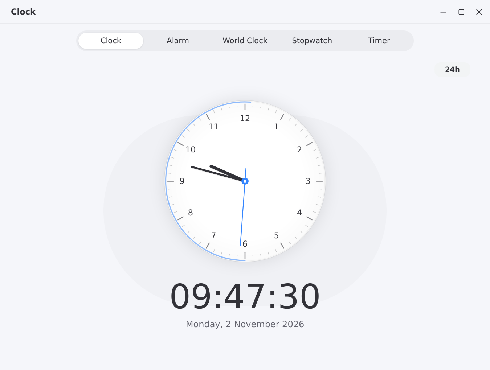
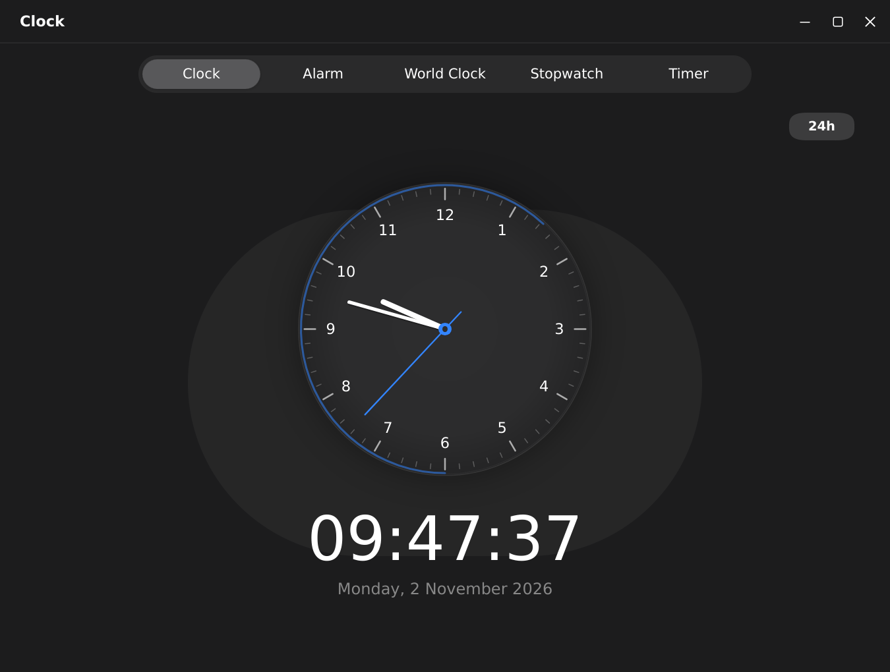
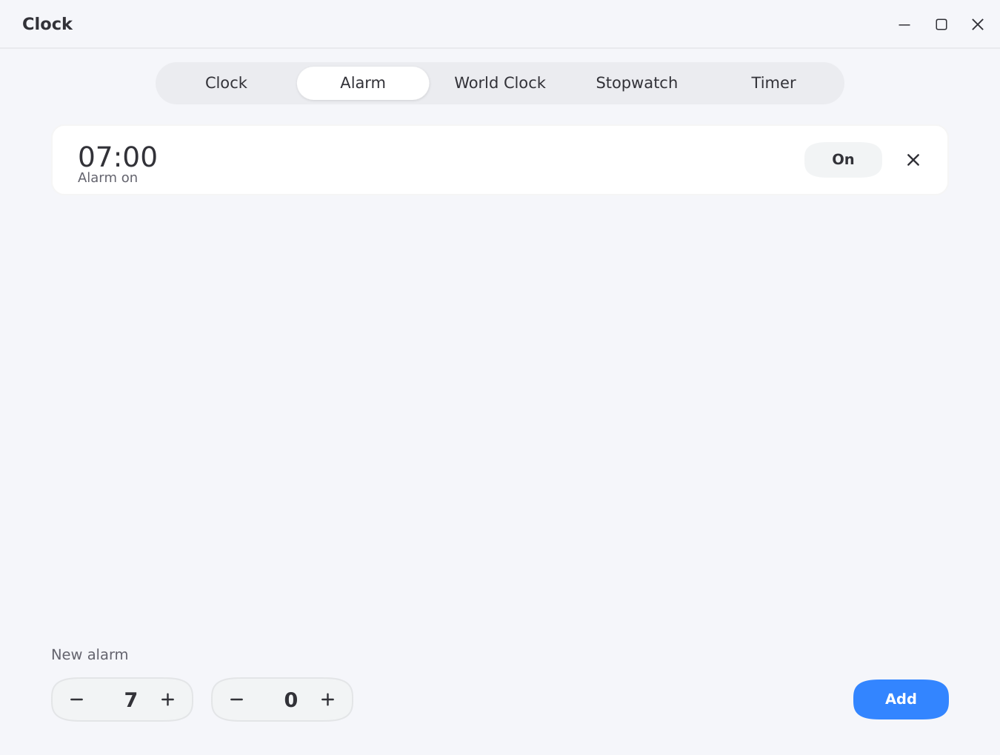

# lingmo-clock

A native clock, world clock, stopwatch and timer for Lingmo OS.

## Features

- Analog and digital clock with date and a 12/24-hour switch
- Daily alarms that run for the whole app session
- World clock for a set of cities
- Stopwatch with laps
- Countdown timer with presets
- Light and dark themes

## Build

```sh
cmake -S . -B build -DCMAKE_PREFIX_PATH=/path/to/lingmo-sdk
cmake --build build
sudo cmake --install build
```

## Screenshots


`n
